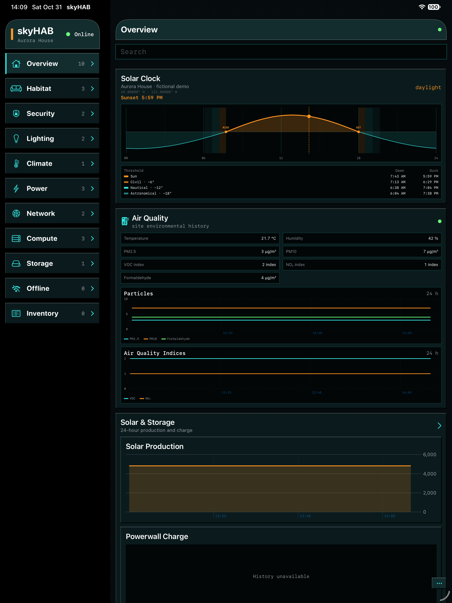
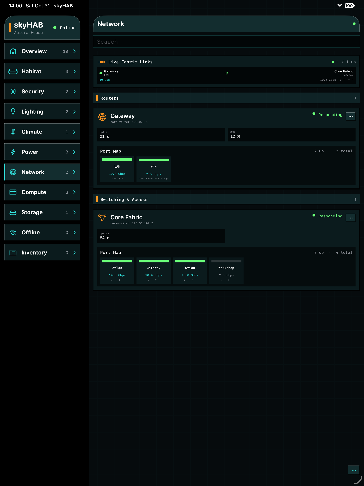
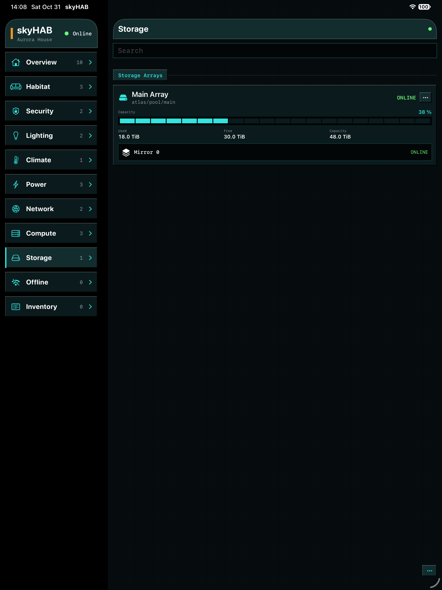
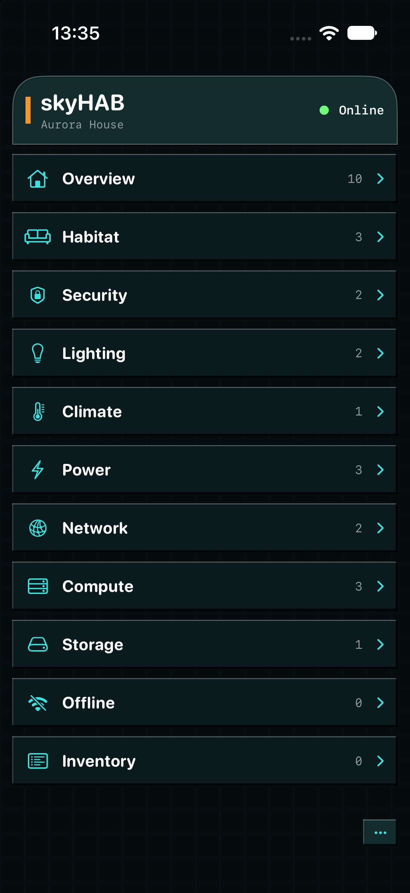

<p align="center">
  
</p>

<h1 align="center">skyHAB</h1>

<p align="center">
  A local-first habitat and infrastructure control plane with a portable C++ middle tier<br>
  and deeply native Apple clients.
</p>

<p align="center">
  <a href="https://github.com/KnowledgeEnvironments/SKYHAB/actions/workflows/ci.yml"></a>
  <a href="LICENSE"></a>
  
  
</p>

**skyHAB — the sky Habitat Automation Builder** — is a local-first software suite for operating
a home, studio, lab, or small site as one coherent resource model. `skyhabd` owns discovery,
telemetry, policy, control verification, and audit; `skyhabctl` provides a JSON-first command
surface; and the native `skyHAB` clients render the model on macOS, iPhone, and iPad. Clients
never need device credentials and never infer topology from addresses or naming conventions.

The project began in **skyLAB**, the original home installation. skyLAB is a proper name
for that site—not a daemon, framework, or name that other installations need to adopt.

## Gallery

| Operational overview | Live network fabric |
|:--:|:--:|
|  |  |

| Storage topology | iPhone console |
|:--:|:--:|
|  |  |

Every image uses the fictional **Aurora House** demo. Its addresses come exclusively from
[RFC 5737](https://www.rfc-editor.org/rfc/rfc5737) documentation ranges.

## What is here

- A C++20 multi-client daemon, SQLite telemetry store, action audit, and CLI.
- Authenticated SkyWire netstring protocol with a 16 MiB frame ceiling.
- Native SwiftUI clients sharing one protocol client, model, state machine, and presentation
  projections across macOS and iOS.
- Server-described views, canonical containment, explicit network relationships, history,
  search, metadata, asset photos, and pending-control reconciliation.
- Adapters for reachability, Shelly, Venstar, NUT, RouterOS, POSIX/SSH, Proxmox, ZFS,
  Enphase, Tesla Powerwall, Dyson MQTT, Envisalink, Meshtastic, RTSP cameras, and a safe
  synthetic demo source.
- A complete fictional inventory that exercises energy, air quality, security, lighting,
  climate, network, compute, storage, and offline lifecycle presentation.

## Quick start: synthetic demo

Requirements: CMake 3.24+, a C++20 compiler, SQLite 3, Swift 6, and macOS 14 or newer for
the desktop client.

```sh
cmake --preset debug
cmake --build --preset debug
tools/run_demo.sh
```

In another terminal:

```sh
SKYHAB_TOKEN=skyhab-demo-local-only swift run --package-path macos skyHAB
```

The demo binds only `127.0.0.1`. Do not reuse its public token for a network deployment.

## Agent and automation CLI

`skyhabctl` is designed for scripts and supervised agents: reads are JSON, credentials stay in a
mode-0600 runtime file, and mutations remain explicit server-audited commands rather than a raw
device shell.

```sh
skyhabctl --help
skyhabctl describe --json
skyhabctl resources --json | jq '.data[] | {id, class, availability}'
skyhabctl events 25 --json
```

Use a dedicated least-privilege identity. Agents should begin with read commands and must not
infer permission to invoke `action` or metadata commands. See the [agentic CLI guide](docs/AGENTIC_CLI.md).

## Configure a real site

1. Copy `inventory/inventory.example.json` outside the checkout, normally to
   `~/Library/Application Support/skyHAB/inventory.json`.
2. Replace the fictional resources and documentation-range addresses with your own site.
3. Keep credentials in a mode-0600 secrets file and reference them by name from inventory.
4. Copy and tailor `presentation/views.json` if your information architecture differs.
5. Start on loopback; expose the cleartext SkyWire listener only on a trusted LAN or through
   a narrow VPN route.

See [Configuration](docs/CONFIGURATION.md), [Operations](OPERATIONS.md), and
[Privacy & release safety](docs/PRIVACY.md) before using real devices.

## Documentation

- [Architecture](ARCHITECTURE.md) — process boundaries, data flow, and control semantics
- [Configuration](docs/CONFIGURATION.md) — first real inventory and runtime files
- [Adapter guide](docs/ADAPTERS.md) — supported integrations and adapter configuration
- [Inventory model](INVENTORY.md) — schema, revisioning, identity, and examples
- [Resource model](RESOURCE_MODEL.md) — ontology, containment, lifecycle, and views
- [SkyWire protocol](PROTOCOL.md) and [command API](API.md)
- [Agentic CLI](docs/AGENTIC_CLI.md) — JSON contracts, permissions, and safe automation patterns
- [Operations & security](OPERATIONS.md) — build, install, tokens, backups, and threat model
- [Apple clients](ios/README.md) — iOS workspace, MobileVLCKit pin, and settings
- [Implementation status](IMPLEMENTATION_STATUS.md) and [changelog](CHANGELOG.md)
- [Contributing](CONTRIBUTING.md), [security policy](SECURITY.md), and
  [release process](docs/RELEASING.md)

## Names

- **skyHAB** is the release and tool suite: the **sky Habitat Automation Builder**.
- **skyhabd** is the authoritative daemon and multi-client middle tier.
- **skyhabctl** is the JSON-first CLI for operators, scripts, and supervised agents.
- **skyHAB** is the native Apple client family.
- **skyLAB** is the proper name of the original home installation and reference deployment.
- **SkyWire** is the authenticated byte-stream protocol between them.

## Security posture

SkyWire is intentionally cleartext and token-authenticated. It is suitable for loopback,
an isolated trusted IoT network, or an authenticated, tightly scoped tunnel—not the public
internet. The deployment transport must provide confidentiality and network isolation. Device
credentials remain server-side. Actions are explicit, audited, followed by a fresh poll, and
reported successful only when the observed field matches the requested state. Infrastructure
mutation remains read-only unless an adapter explicitly documents a narrow action surface.

Apple and other product names are used only to describe compatibility. skyHAB is an independent
project and is not affiliated with or endorsed by Apple Inc. or any other named vendor.

## License and authorship

skyHAB Project &lt;src@lispm.net&gt;

Copyright (c) 2026 I. Finder.
Released under the [MIT License](LICENSE). Third-party components retain their own licenses;
see [THIRD_PARTY_NOTICES.md](THIRD_PARTY_NOTICES.md).
